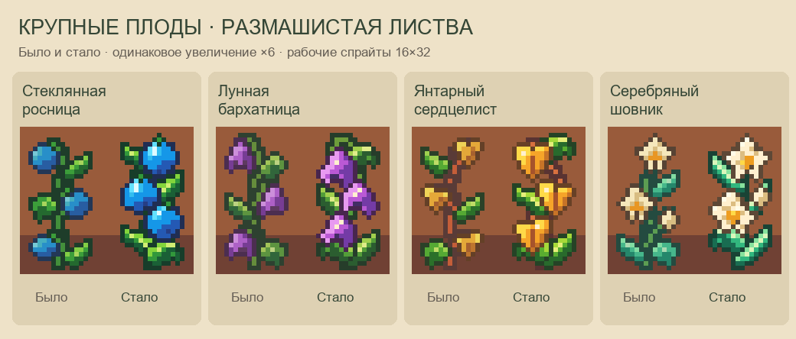

# Аптекарский сад: рисунок сразу в игровом размере

Текущая версия — `native-v14`, 31 октября 2026.

Все 24 стадии роста нарисованы непосредственно на сетке 16×32, урожай и
семена — на сетке 16×16. Форма листа, ягоды, колокольчика и лепестков
задаётся конкретными пикселями. Нет уменьшения крупных изображений,
сглаживания, подбора палитры по живописному рисунку или расширения обводки.



- Редактируемый источник — `native-v14/pixels.json`. Один символ — один
  пиксель; точка означает прозрачность. Все строки имеют ширину 16 символов.
- Инструмент рисования компонентов — `../../scripts/compose_native_herbs.py`.
  Он размещает пиксельные листья и части урожая по целым координатам и
  записывает полные карты. Отдельный лист — от 9×8 до 9×10, ягода — 9×9,
  колокольчик — 9×10, золотое сердце — 9×9, раскрытый белый цветок — 11×11.
  Для маленьких эмблем на пакетах сохранены отдельные компактные формы.
- Рабочий экспортёр — `../../scripts/native_herbal_garden.py`: только
  расшифровка символов по фиксированной палитре и упаковка готовых ячеек.
- 32 отдельных PNG конечного размера — `native-v14/tiles/`.
- [Все стадии](native-v14/preview.png) · [Два фона](native-v14/garden-preview.png).
  Только превью увеличены целое число раз ближайшим соседом.

У росницы три крупные голубые ягоды с яркими ледяными бликами, у бархатницы
три свисающих расширяющихся книзу колокольчика. У сердцелиста три золотых
листа с двумя верхними долями, выемкой и нижним остриём. У шовника два
белых пятилепестковых цветка с золотым центром и закрытый бутон. Листовые
пластины занимают большую часть ширины клетки, расходятся по диагонали и
загибаются на концах. Плоды и цветки образуют перекрывающиеся группы на
изогнутых стеблях. Ягоды, колокольчики и золотые листья имеют три варианта,
раскрытые цветки — два. Светлые блики, насыщенные световые плоскости и
глубокие цветные тени подчёркивают объём. Контуры тёмные, цвета материала.

Художественный ориентир создан встроенным imagegen и сохранён отдельно:
`native-v14/art-direction.png`, полный промпт — `native-v14/art-direction.md`.
Он использовался как визуальный референс. Игровые PNG нарисованы заново
на нативной сетке; пиксели крупного референса в них не уменьшались.

Вся палитра содержит 51 заранее выбранный цвет, альфа только 0/255.
Контур уже входит в пиксельные силуэты, сохраняет цвет материала и имеет
яркость 16–80/255 по контракту валидатора. Прозрачные поля отделяют ячейки.

| Лист | Рабочий путь | Размер |
| --- | --- | --- |
| herbalItems.png | assets/Items/herbalItems.png | 128×16 |
| herbalCrops.png | assets/Crops/herbalCrops.png | 256×64 |

`exports/` содержит рабочие листы, восемь отдельных иконок и по шесть
кадров каждого растения. Порядок видов: росница, бархатница, сердцелист,
шовник. Предметы: урожай 0–3, семена 4–7.

Формат Crop.getSourceRect сохранён: две культуры на строку, по восемь
ячеек 16×32. Порядок: посев, посев, росток, молодое, бутоны, зрелое,
зрелое, после сбора. Нижний пиксель y=30, крайние столбцы прозрачны.

Из папки CP-пака:

```powershell
python scripts/native_herbal_garden.py --install
python scripts/check_all.py
```

Для изменения компонентного рисунка отредактировать
`compose_native_herbs.py`, выполнить его, затем выполнить экспортёр.
Для правки отдельного пикселя можно изменить `pixels.json` и выполнить
только экспортёр. `scripts/painted_herbal_garden.py` и
`art/herbal-garden/export_assets.py` перенаправлены на нативный экспортёр.
`draw_native_icons.py` берёт иконки из тех же пиксельных карт.

`--install` обновляет рабочий каталог проекта. `native-v14/report.json`
содержит размеры, хеш источника и метод без уменьшения; проверки —
`native-v14/validation.txt`. Предыдущие PNG, экспортёры и документы
сохранены в `native-v14/before/`. Источники и превью предыдущей нативной
версии остаются в `native-v13/`. Крупные рисунки v12 и более ранних
версий оставлены в архиве. В запущенной игре этот вариант не проверялся.
Механики сада — в `../../docs/herbal-garden.md`.
