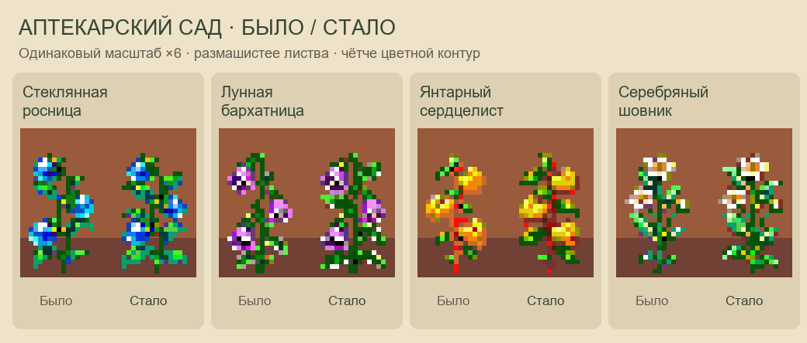

# Аптекарский сад: крупные рисунки → игровые спрайты

Текущая версия — `painted-v10`, 30 октября 2026.

У зрелых растений широкие листья расходятся в стороны отдельными дугами.
Боковые лопасти и нижние пары листьев увеличены, между ними видны стебли.
Крупные голубые ягоды росницы, сиреневые колокольчики бархатницы и белые
цветы шовника сохранены. Сердцелист сохраняет три золотых листа-сердечка.
Цветной контур стал чётче за счёт тени внутри нижнего и правого края.



- Четыре новых крупных портрета зрелых растений созданы встроенным imagegen:
  `painted-v10/mature-portraits/`. У каждого вида изменена форма зелёной листвы.
- Промпты и пути входных изображений — `painted-v10/mature-prompts.json`.
- Исходники остальных стадий, урожая и семян скопированы из v9 в
  `painted-v10/sources/`. На каждом листе два столбца и четыре строки.
  Исходные промпты этих листов — `painted-v9/prompts.json`.
- 32 отдельных крупных рисунка — `painted-v10/isolated/`.
- Уменьшенные промежуточные PNG — `painted-v10/reduced-before-outline/`.
- Сборщик — `../../scripts/painted_herbal_garden.py`; цвет и резкость —
  `../../scripts/refine_herbal_pixels.py`. Пересборка работает локально с PNG.

Альфа-канал уменьшается пропорционально; цвет берётся из промежуточного
изображения тройного размера ближайшим соседом. Это сохраняет чёткие границы
материалов и небольшие блики. Локальная резкость использует только непрозрачных
соседей, поэтому вокруг веток нет светлой или чёрной каймы. На достаточно
широких участках нижний и правый край затемнён сильнее верхнего и левого;
тонкие стебли сохраняют цвет. Контур остаётся цветным, яркость его пикселей
не ниже 60/255. Листва сохраняет насыщенные зелёные тени и цветные блики.

В игровых PNG только альфа 0/255, до 48 внутренних и 16 цветов края,
суммарно не более 64 непрозрачных цветов. Внешняя обводка не расширяет рисунки.

[Исходники и результат](painted-v10/reduction-preview.png) · [Все стадии](painted-v10/preview.png) · [Два грунта](painted-v10/garden-preview.png).
Превью увеличивают готовые игровые PNG ближайшим соседом. Маленькие иконки
рядом с увеличенными показываются в настоящих 16×16.

| Лист | Рабочий путь | Размер |
| --- | --- | --- |
| herbalItems.png | assets/Items/herbalItems.png | 128×16 |
| herbalCrops.png | assets/Crops/herbalCrops.png | 256×64 |

`exports/` содержит рабочие листы, восемь отдельных предметов и по шесть
стадий 16×32 каждого растения. Порядок видов: росница, бархатница,
сердцелист, шовник. Предметы: урожай 0–3, семена 4–7.

Формат Crop.getSourceRect сохранён: две культуры на строку, по восемь ячеек.
Порядок: посев, посев, росток, молодое растение, бутоны, зрелое, зрелое,
после сбора. Нижний пиксель — y=30; прозрачное поле отделяет соседние ячейки.

Из папки CP-пака:

```powershell
python scripts/painted_herbal_garden.py --install
python scripts/validate_herbal_garden.py
python scripts/validate_native_icons.py
python scripts/check_all.py
```

Старые точки входа `scripts/native_herbal_garden.py` и
`art/herbal-garden/export_assets.py` вызывают текущий сборщик. Общий генератор
`draw_native_icons.py` также использует новые иконки. `--install` обновляет
рабочий каталог мода, без изменения установленной игры.

`painted-v10/report.json` содержит размеры, цвета, хеши и порядок кадров;
`painted-v10/validation.txt` — проверки. Предыдущие рабочие PNG, сборщики
и документация сохранены в `painted-v10/before/`. Предыдущие рисунки и превью
находятся в `painted-v9`, `painted-v8`, `painted-v7` и более ранних папках.
В запущенной игре текущий вариант не проверялся. Механики сада описаны
в `../../docs/herbal-garden.md`.
