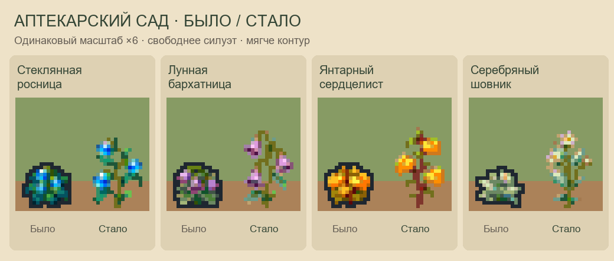

# Аптекарский сад: крупные рисунки → игровые спрайты

Текущая версия — `painted-v6`, 29 октября 2026.

Встроенный `image_gen` переработал четыре крупных прозрачных листа:
по одному для росницы, бархатницы, сердцелиста и шовника. Каждый
содержит шесть стадий растения, отдельный урожай и пакет семян. Затем рисунки
уменьшены до игровых размеров. Новые силуэты выше и свободнее: листья и
плоды разнесены по веточкам, между ними видны просветы. Мягкий оливковый
цветной край добавлен после уменьшения, без расширения рисунка наружу.



- Исходные листы — `painted-v6/sources/`, 32 вырезанных рисунка — `painted-v6/isolated/`.
- Полные промпты — `painted-v6/prompts.json`; использован встроенный image_gen.
- Промежуточные уменьшенные PNG без контура — `painted-v6/reduced-before-outline/`.
- Сборщик — `../../scripts/painted_herbal_garden.py`. Он работает локально с сохранёнными PNG.
- Уменьшение пропорциональное, LANCZOS; порог альфа-канала убирает полупрозрачную кромку.
- Палитра подбирается методом максимального покрытия, чтобы сохранить голубые ягоды,
  сиреневые колокольчики и светлые блики. Всего не более 64 непрозрачных цветов.
- Контур — приглушённые оттенки самого растения с 35% оливкового `#4e624c`,
  один игровой пиксель по существующей кромке. Палитра: до 48 внутренних и
  16 цветов края, суммарно не более 64.
  Внешней дилатации нет: тонкие ветки не утолщаются, просветы сохраняются.
  Прозрачность только 0/255.
- В листе культур край дополнительно осветлён на 8%; геометрия и внутренние цвета сохранены.

Росница — округлые голубые стеклянные ягоды и тёмно-бирюзовые листья;
бархатница — свисающие сиреневые колокольчики с тёмным зевом;
сердцелист — золотистые листья-сердечки на красноватых ветках;
шовник — заострённые серебристо-мятные листья и светлый цветок.

[Исходники и результат](painted-v6/reduction-preview.png) · [Все стадии](painted-v6/preview.png) · [На двух грунтах](painted-v6/garden-preview.png).
Превью увеличивают готовые игровые PNG ближайшим соседом. Маленькие иконки
рядом с увеличенными показываются в настоящих 16×16.

| Лист | Рабочий путь | Размер |
| --- | --- | --- |
| herbalItems.png | assets/Items/herbalItems.png | 128×16 |
| herbalCrops.png | assets/Crops/herbalCrops.png | 256×64 |

`exports/` содержит рабочие листы, восемь отдельных предметов и по шесть
стадий 16×32 каждого растения. Порядок видов: росница, бархатница,
сердцелист, шовник. Предметы: урожай 0–3, семена 4–7.

Культуры сохраняют формат Crop.getSourceRect: две культуры на строку,
по восемь ячеек. Порядок: посев, посев, росток, молодое растение, бутоны,
зрелое, зрелое, после сбора. Нижний пиксель — y=30; прозрачное поле отделяет
соседние ячейки. Раскладка и индексы игровых данных сохранены.

Из папки CP-пака:

```powershell
python scripts/painted_herbal_garden.py --install
python scripts/validate_herbal_garden.py
python scripts/validate_native_icons.py
python scripts/check_all.py
```

Старые команды `python scripts/native_herbal_garden.py --install` и
`python art/herbal-garden/export_assets.py --install` вызывают тот же сборщик.
Общий генератор `draw_native_icons.py` использует новые иконки, поэтому
пересборка не вернёт старые рисунки. `--install` обновляет исходники мода
в рабочем каталоге; папка установленной игры не затрагивается.

`painted-v6/report.json` содержит размеры, цвета, хеши исходников и результатов,
метод обработки и порядок кадров. Предыдущие рабочие PNG, экспортёр, исходники
и документация сохранены в `painted-v6/before/`. Крупные исходники прошлой
версии находятся в `painted-v5/`, более ранние — в `native-v2`, `native-v3`,
`native-v4` и `generated`.

Размеры, поля ячеек, непрозрачный контур, прозрачность, все фазы, повторный сбор,
рабочие копии, рецепты и цепочка поручений проверяются существующими валидаторами.
Графика осмотрена в увеличении и на двух цветах грунта. Проверка в запущенной
игре не выполнялась. Механики сада описаны в `../../docs/herbal-garden.md`.
